<picture>
	<source media="(prefers-color-scheme: dark)" srcset="./assets/sombre/entete.svg">
	
</picture>

<picture>
	<source media="(prefers-color-scheme: dark)" srcset="./assets/sombre/presentation.svg">
	
</picture>

<picture>
	<source media="(prefers-color-scheme: dark)" srcset="./assets/sombre/defilement.svg">
	
</picture>

 

<picture>
	<source media="(prefers-color-scheme: dark)" srcset="./assets/sombre/titre-01.svg">
	
</picture>

<picture>
	<source media="(prefers-color-scheme: dark)" srcset="./assets/sombre/fiche.svg">
	
</picture>

 

<picture>
	<source media="(prefers-color-scheme: dark)" srcset="./assets/sombre/titre-02.svg">
	
</picture>

<picture>
	<source media="(prefers-color-scheme: dark)" srcset="./assets/sombre/parcours.svg">
	
</picture>

 

<picture>
	<source media="(prefers-color-scheme: dark)" srcset="./assets/sombre/titre-03.svg">
	
</picture>

<a href="https://github.com/Joshua-Hermilly/MateZone">
	<picture>
		<source media="(prefers-color-scheme: dark)" srcset="./assets/sombre/projet-matezone.svg">
		
	</picture>
</a>

	<a href="https://github.com/Joshua-Hermilly/MateZone"><picture><source media="(prefers-color-scheme: dark)" srcset="./assets/sombre/bouton-code.svg"></picture></a>
	&nbsp;
	<a href="https://www.m8yuriko.fr"><picture><source media="(prefers-color-scheme: dark)" srcset="./assets/sombre/bouton-site.svg"></picture></a>
	&nbsp;
	<a href="https://github.com/Joshua-Hermilly/MateZone/releases"><picture><source media="(prefers-color-scheme: dark)" srcset="./assets/sombre/bouton-release.svg"></picture></a>

<picture>
	<source media="(prefers-color-scheme: dark)" srcset="./assets/sombre/projet-paddock.svg">
	
</picture>

  

<a href="https://github.com/Dono0530/MateSpace">
	<picture>
		<source media="(prefers-color-scheme: dark)" srcset="./assets/sombre/projet-matespace.svg">
		
	</picture>
</a>

	<a href="https://github.com/Dono0530/MateSpace"><picture><source media="(prefers-color-scheme: dark)" srcset="./assets/sombre/bouton-code.svg"></picture></a>

<a href="https://github.com/Joshua-Hermilly/SAE_4-01-Application-de-profilage-de-dossier---WEB">
	<picture>
		<source media="(prefers-color-scheme: dark)" srcset="./assets/sombre/projet-parcoursup.svg">
		
	</picture>
</a>

	<a href="https://github.com/Joshua-Hermilly/SAE_4-01-Application-de-profilage-de-dossier---WEB"><picture><source media="(prefers-color-scheme: dark)" srcset="./assets/sombre/bouton-code.svg"></picture></a>

 

<picture>
	<source media="(prefers-color-scheme: dark)" srcset="./assets/sombre/titre-04.svg">
	
</picture>

| Projet | Cadre | En bref | Stack |
| :-- | :-- | :-- | :-- |
| [**MateGraph**](https://github.com/Joshua-Hermilly/MateGraph) | Projet académique | Saisie de graphes et calcul du plus court chemin, étape par étape (Dijkstra, Bellman-Ford) | Java · Swing · GraphStream |
| [**Rétro-conception Java → UML**](https://github.com/Joshua-Hermilly/S3-01-Outil-retro-conception-Java-UML) | SAE 3.01 · équipe de 5 | Génère un diagramme UML éditable à partir de code Java, en interface graphique ou console, avec sauvegarde XML | Java · JDOM |
| [**Gestionnaire MPM**](https://github.com/Joshua-Hermilly/SAE_2-01-Graphe-MPM---Java) | SAE 2.01 · équipe | Implémentation complète de la méthode MPM pour planifier et ordonnancer des projets | Java |
| [**Déploiement Docker**](https://github.com/Joshua-Hermilly/docker-sae203) | SAE 2.03 | Déploiement conteneurisé de MateZone et virtualisation sous Linux | Docker · Linux |
| [**Jeu de plateforme 2D**](https://github.com/Joshua-Hermilly/S1.01-Platformer) | SAE 1.01 | Niveaux décrits dans des fichiers texte : déplacements, échelles et sortie à atteindre | Java |

 

<picture>
	<source media="(prefers-color-scheme: dark)" srcset="./assets/sombre/titre-05.svg">
	
</picture>

<picture>
	<source media="(prefers-color-scheme: dark)" srcset="./assets/sombre/stack.svg">
	
</picture>

 

<picture>
	<source media="(prefers-color-scheme: dark)" srcset="./assets/sombre/titre-06.svg">
	
</picture>

<picture>
	<source media="(prefers-color-scheme: dark)" srcset="./assets/sombre/statistiques.svg">
	
</picture>

 

<picture>
	<source media="(prefers-color-scheme: dark)" srcset="./assets/sombre/titre-07.svg">
	
</picture>

	<a href="mailto:joshua@hermilly.fr"><picture><source media="(prefers-color-scheme: dark)" srcset="./assets/sombre/bouton-email.svg"></picture></a>
	&nbsp;
	<!-- <a href="https://joshua.hermilly.fr/"><picture><source media="(prefers-color-scheme: dark)" srcset="./assets/sombre/bouton-portfolio.svg"></picture></a> -->

 

<picture>
	<source media="(prefers-color-scheme: dark)" srcset="./assets/sombre/pied.svg">
	
</picture>
